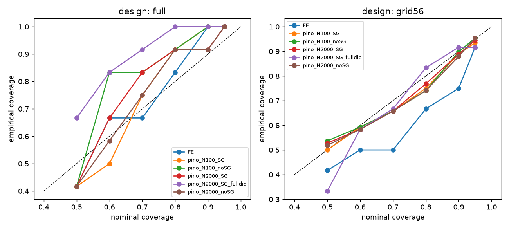
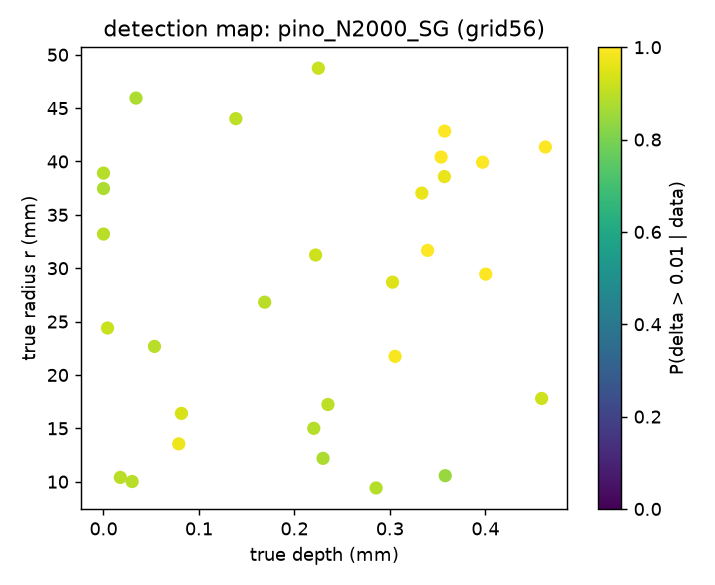

# Neural-operator surrogates for Bayesian identification of corrosion thickness loss from DIC strain fields

**Technical report: baseline study**

Status: baseline results (laptop run, 2026-11-23). An improvement study is in progress.
This report will be revised when the improvement study is complete.

Writing style: this report uses a controlled-language style similar to ASD-STE100
(Simplified Technical English).

---

## Abstract

Corrosion decreases the thickness of steel plates. This decrease is frequently not visible,
and it decreases the load capacity of the plate. Digital image correlation (DIC) measures
the surface strain of a plate under load. A local thickness loss changes this strain field.
Thus, it is possible to identify the loss from DIC data with Bayesian inference. Bayesian
inference needs many evaluations of the forward model, and a finite element (FE) model is slow.

In this study, we replace the FE model with a neural-operator surrogate. We train a Fourier
neural operator (FNO) and a physics-informed neural operator (PINO) on FE solutions of a
plate in tension. The input is the thickness field and Poisson's ratio. The output is the
displacement field. We add the surrogate error to the likelihood as a covariance term
(Σ_G). We use a virtual DIC pipeline to get a realistic noise model.

The surrogates have a relative strain error of 1.2–1.3 % with 2000 training samples. The
physics loss gives no measurable improvement over the FNO. In a benchmark of 30 synthetic
cases, the 90 % credible intervals cover the true pit parameters in 85–93 % of the cases. The
posteriors agree with the FE-in-the-loop reference within 0.024 of the prior width. The Σ_G
term has no effect at the noise level of this study. The derived net-section capacity has a
coverage of only 0.76. A 3D check shows that one-sided corrosion bends the plate. The face strain
changes by more than the damage signal. Thus, the 2D membrane model is not sufficient for
single-face DIC of one-sided corrosion.

---

## 1 Motivation

Steel plates in bridges, ships and tanks lose thickness because of corrosion. The loss is
frequently on the hidden face of the plate. Engineers must know the remaining thickness to
calculate the remaining capacity. Ultrasonic thickness measurement gives data at single
points only. It is slow on large areas.

DIC gives a full strain field from photographs of the loaded plate. A local loss of
thickness causes a local increase of the strain. Thus, the strain field contains information
about the size, the location and the depth of the loss. To use this information, we must
solve an inverse problem.

The inverse problem is ill-posed. Different thickness fields can give almost the same strain
field. The DIC data also have noise. Thus, a single "best" thickness field is not sufficient.
Engineers need the uncertainty of the result. Bayesian inference gives this uncertainty as a
posterior distribution.

Bayesian inference needs 10^4 to 10^5 forward evaluations for each data set. One 2D FE
solution of the plate takes 0.2 s on one CPU core. A 3D solution takes approximately 45 s.
Thus, FE-in-the-loop inference is slow, and it is not practical for 3D models or for many
inspections. A fast surrogate can make the inference practical. But the surrogate has an
error. If the likelihood does not include this error, the posterior can be too narrow.

---

## 2 Introduction

### 2.1 Problem

We study a steel plate in uniaxial tension. The plate has a local thickness loss. The
camera of a DIC system records the strain field on the plate surface at three load levels.
The task is to find the posterior distribution of the damage parameters from the DIC data.

### 2.2 Approach

We use these components:

1. A 2D plane-stress FE model of the plate. The thickness is a field on the FE grid.
2. Three damage models: a Gaussian pit, a Karhunen–Loève (KL) random field, and a triangle
   (only for tests outside the training distribution).
3. A virtual DIC pipeline. It renders speckle images of the deformed plate, and it does a
   subset-based DIC analysis. We use it to calibrate the DIC filter and the DIC noise.
4. Neural-operator surrogates (DeepONet, FNO, PINO). They map the thickness field to the
   displacement field.
5. A Gaussian likelihood with the DIC noise covariance Σ_DIC and the surrogate-error
   covariance Σ_G.
6. Two samplers: transitional Markov chain Monte Carlo (TMCMC) and the No-U-Turn Sampler (NUTS).

### 2.3 Questions

The study answers these questions:

1. How many FE solutions are necessary to train an accurate surrogate?
2. Does the physics loss of the PINO decrease the error or the necessary data?
3. Are the surrogate posteriors calibrated, and do they agree with FE-in-the-loop posteriors?
4. Does the Σ_G term change the posteriors?
5. Does the method work on real DIC data?
6. Can we propagate the posterior to the load capacity?

### 2.4 Scope and limits

The plate geometry is from the tension tests of Sato and Nishio (2025). The main study uses
synthetic data with a realistic noise model. One validation uses a public DIC data set of a
plate with a hole (Zenodo record 11257192). The tests with our own coupons are not done yet.

All runs use one laptop (NVIDIA RTX 3050 Ti, 4 GB, under WSL2) and the free Kaggle GPUs. The
compute budget is approximately 1/10 of the original plan. Section 5 gives the effects of
this decrease.

---

## 3 Methodology

### 3.1 Plate and FE model

The plate has a free length L = 300 mm, a width W = 250 mm and a thickness t0 = 3.2 mm. The
material is linear elastic with E = 206 GPa and ν = 0.30. The local thickness is t(x, y) = t0·τ(x, y).

The FE model uses plane stress and bilinear (Q1) elements on a 150 × 125 grid (2 mm
elements, approximately 38 000 unknowns). The FE code is FEniCSx 0.9. The left edge has a
roller support (u1 = 0). One corner node has u2 = 0. The right edge has a uniform line load
with the total force P.

The model is nondimensional (E = 1, P = 1). The solution at a load P and a modulus E is the
nondimensional solution multiplied by P/(E·t0). Thus, one solution gives the data for all
load levels and all values of E. The thickness enters each element as the mean of its four
nodal values.

We verified the FE model with four checks:

- A uniform plate gives the analytical strain with a relative error of less than 2·10^-10.
- The solution scales linearly with the load (difference less than 10^-12).
- The peak strain near a pit changes by 0.17 % when the element size changes from 2 mm to 1 mm.
- Quadratic (Q2) elements give the same peak strain as Q1 elements within 0.01 %.

### 3.2 Damage models

The **pit model** has four parameters: the centre (xc, yc), the radius r and the depth δ
(a fraction of t0):

τ(x, y) = 1 − δ · exp(−((x − xc)² + (y − yc)²) / (2r²))

The prior is uniform: xc in [50, 250] mm, yc in [30, 220] mm, r in [8, 50] mm and δ in
[0, 0.15] (a maximum depth of 0.48 mm). E is uniform in [196, 216] GPa, and ν is uniform in
[0.27, 0.33]. Thus, the full parameter vector is θ = (xc, yc, r, δ, E, ν).

The **KL model** describes general corrosion. A Gaussian random field g has a squared
exponential covariance with a correlation length ℓ of 20 mm or 40 mm. We keep the KL terms
for 95 % of the variance (maximum 110 terms). The thickness is
τ = 1 − 0.15 · sigmoid(g − c), where c in [1, 2.5] controls the corroded area.

The **triangle model** has a uniform loss inside a random triangle (edge length 30–120 mm,
δ in [0.02, 0.15]). We use it only to test the surrogates outside the training distribution.

### 3.3 Data sets

We generated these FE data sets with Sobol samples of the priors:

| Set | Damage model | Size | Use |
|---|---|---|---|
| A | pit | 5000 | training, validation, test (4000 / 500 / 500) |
| B | KL | 5000 | training, validation, test (4000 / 500 / 500) |
| C | triangle | 300 | test outside the training distribution |
| D_pit, D_kl | pit, KL | 500 each | estimation of Σ_G (held out) |
| U | pit + KL | 20 000 | unlabelled thickness fields for the physics loss |

Each sample stores the thickness field, ν and the displacement perturbation
w = u − u0, where u0 is the solution of the intact plate.

### 3.4 Virtual DIC and observation operator

We made a virtual DIC pipeline, because the DIC software DICe needs Trilinos. The pipeline
renders speckle images of the plate (0.06 mm per pixel, 5000 × 4200 pixels). It deforms
the images with the FE displacement. It then does a local subset DIC analysis on the GPU:

- first-order subset shape functions and the ZNSSD criterion,
- inverse-compositional Gauss–Newton iterations,
- cubic B-spline interpolation of the image grey levels,
- subsets with a radius of 60 pixels and a step of 20 pixels,
- a virtual strain gauge (VSG) with a 5 mm window.

Bicubic interpolation caused a bias of 0.02–0.03 pixels. This bias gave strain errors of
±40 µε, which is more than the damage signal. B-spline interpolation decreased the bias by a
factor of approximately 10.

DIC acts as a low-pass filter on the strain. We model this effect with a Gaussian filter of
width ℓ_f, followed by bilinear sampling at the DIC points. This operator is H. We fitted
ℓ_f from the DIC transfer function of sinusoidal strain fields (wavelengths 6–32 mm). The
result is ℓ_f = 2.6 mm.

We use two DIC point designs:

- **grid56**: 7 × 8 = 56 points on the region of interest (the design of the reference tests),
- **full**: 217 × 200 points with a 1.2 mm spacing (x = 20–280 mm, y = 5–245 mm).

The loads are 30, 50 and 80 kN. Each data vector contains three strain components at all
points for all three loads.

### 3.5 DIC noise model

We calibrated the camera read noise of the virtual DIC. The calibration target is a
strain scatter of 30 µε at a subset radius of 60 pixels. **This target is a placeholder**,
because we did not have the histogram of the reference paper. The calibrated read noise is
8.0 grey levels. It gives a scatter of 29.9 µε.

We then measured the DIC error on 12 strain fields with 30 speckle patterns each. For each
strain component, we fitted a stationary squared-exponential covariance plus a white-noise
term (nugget). The fitted values are:

| Component | σ (µε) | Correlation length (mm) |
|---|---|---|
| ε11 | 30.1 | 2.45 |
| ε22 | 29.9 | 2.42 |
| ε12 | 21.2 | 2.42 |

The fitted nugget is almost zero, because the VSG output is smooth. This makes the
full-field covariance almost singular (condition number of approximately 10^12). Thus, the
likelihood uses a white-noise floor of 0.1 σ (approximately 3 µε).

On a rectilinear DIC grid, the covariance is a Kronecker product. Thus, the full-field
likelihood is exact and fast. It uses only 1D eigendecompositions.

### 3.6 Surrogate models

All surrogates map the inputs (τ − 1)/0.15, x/L, y/W and (ν − 0.30)/0.03 on the 126 × 151
node grid to the normalised displacement perturbation w.

- **DeepONet**: a convolutional branch network and a Fourier-feature trunk network (128 basis functions).
- **FNO**: 4 Fourier layers, 64 channels, 32 × 32 modes, padding to a 144 × 168 grid.
- **PINO**: the same FNO with an added physics loss.

The data loss is the relative L2 error of w plus the relative L2 error of its strain. The
physics loss of the PINO is the discrete Q1 FE residual ||K(τ, ν)u − f||² / ||f||². This
residual uses the same discrete system as the FE model. Thus, FE data have a residual of
less than 10^-10. The first 10 % of the steps use the data loss only. After this warm-up, the PINO applies the
residual to the labelled samples and to the unlabelled set U. We selected
the residual weight λ_r from {0.01, 0.1, 1} at N = 500 for each family. The result was 1.0.

The training uses Adam (learning rate 10^-3, cosine decrease to 10^-5) with a batch of 16
for 8000 steps. The original plan has 60 000 steps.

The error metric is the relative L2 error of the strain perturbation after the operator H
(full design), pooled over the test set.

### 3.7 Bayesian inference

The likelihood is Gaussian:

d = G(θ) + e,  e ~ N(μ_G, Σ_DIC + Σ_G)

G(θ) is the predicted DIC data in µε for all loads. Σ_DIC is the DIC noise model.

**Σ_G** is the covariance of the surrogate error. We calculate the residuals
R = H(ε_FE) − H(ε_surrogate) on the held-out set D. Σ_G contains the 20 largest principal
components of R, and its mean μ_G is the mean of R. The variance of the other components is
added to the nugget. The surrogate error scales with the load. Thus, Σ_G is fully correlated
across the three loads. The likelihood applies Σ_G with the Woodbury identity.

**TMCMC** (Ching and Chen, 2007) is the main sampler. Our version is adaptive. It tunes the
proposal scale to an acceptance rate of 23 %. Each stage continues until 60 % of the
particles have moved. The laptop runs use 1000 particles (the plan has 4000). The model
evidence is a by-product of TMCMC.

**NUTS** (Hoffman and Gelman, 2014, in Pyro) is a check of TMCMC. It uses gradients through
the surrogate. The laptop runs use 2 chains with 500 warm-up and 500 samples, and a maximum
tree depth of 8.

**FE-in-the-loop TMCMC** is the reference. It uses the same likelihood without Σ_G and 10
parallel FE workers.

### 3.8 Benchmark

The benchmark has 30 cases from the pit prior. Three cases are intact (δ = 0). The data are
FE solutions plus noise from the fitted noise model. The grid56 design uses all 30 cases.
The full design uses the first 6 cases.

The conditions are:

- PINO trained with N = 100 or N = 2000 samples, each with and without Σ_G,
- FE-in-the-loop reference on 3 damaged cases for each design,
- data from the full image pipeline (rendered images and DIC) on 6 cases, with the PINO N = 2000 and Σ_G.

The metrics are:

- the empirical coverage of the 90 % credible intervals of xc, yc, r and δ (damaged cases),
- the Wasserstein-1 distance (W1) between the surrogate posterior and the FE reference,
  divided by the prior width,
- the detection probability P(δ > 0.01 | data).

The gates of the plan are a 90 % coverage in [0.85, 0.95] and W1 < 0.1.

### 3.9 Validation on real data

We used the public data set of Tröger, Hartmann, Anton and Wessels (Zenodo 11257192). It contains DIC displacements of an S235 steel plate with a hole. The parallel length is
80 mm, the width 20 mm, the thickness 3.05 mm and the hole radius 4 mm. Anton et al. (2024) give the traction
(106.26 N/mm²) and their FE-based estimate of the elastic constants (E = 185.2 GPa,
ν = 0.259).

We represent the hole as a region with τ = 10^-3 on a 0.5 mm grid. At 2 mm or more from the hole edge, the strain of this representation is within 1 % of an FE
model with a meshed hole. We trained a PINO on 2000 FE solutions of this geometry. The parameters
are the hole centre, the hole radius, E, ν, three rigid-body terms and two noise scales. The
likelihood uses independent noise on u_x and u_y.

### 3.10 Capacity

We propagate the posterior samples to two capacity estimates:

- the **net-section capacity** P_u = σ_u · min over x of ∫ t dy, with σ_u = 400 MPa (a
  placeholder until coupon tests give σ_u),
- a **CalculiX** elasto-plastic shell analysis (yield 245 MPa, hardening 1/100 of E). The
  capacity is the load at the 0.2 % offset of the force-elongation curve.

### 3.11 Software and hardware

All code runs in one Docker image (FEniCSx 0.9, PyTorch 2.7 with CUDA 12.6, neuraloperator
1.0.2, Pyro, CalculiX). The local computer is a laptop with an RTX 3050 Ti GPU (4 GB) and
12 CPU threads under WSL2. The GPU throttles thermally. The surrogate training ran on Kaggle
(2 × NVIDIA T4) in two sessions. All results come from one configuration file (`configs/laptop.yaml`). Each result file
contains the hash of its configuration.

---

## 4 Results

### 4.1 One-sided corrosion bends the plate (3D check)

The 2D model assumes that the strain is constant through the thickness. Corrosion on one
face moves the neutral axis, and the tension load then bends the plate. We measured this
effect with a 3D solid model (Q1 hexahedra, 4 layers, 42–48 s for each solution).

All pits of this check are at the centre of the plate. The table gives the difference
between the face strain and the 2D membrane strain, after the operator H on the full design.
The differences are divided by the damage signal (the strain change that the pit causes in
the 2D model).

| Pit depth (mm) | Pit radius (mm) | Max. difference / max. signal, flat face | Same, corroded face | L2 difference / L2 signal, flat face | Same, corroded face |
|---|---|---|---|---|---|
| 0.05 | 10 | 1.37 | 1.41 | 1.68 | 1.70 |
| 0.05 | 30 | 1.30 | 1.30 | 1.58 | 1.59 |
| 0.1 | 10 | 1.37 | 1.40 | 1.68 | 1.71 |
| 0.1 | 30 | 1.30 | 1.29 | 1.58 | 1.59 |
| 0.2 | 10 | 1.37 | 1.39 | 1.68 | 1.72 |
| 0.2 | 30 | 1.30 | 1.28 | 1.58 | 1.60 |
| 0.4 | 10 | 1.36 | 1.36 | 1.67 | 1.74 |
| 0.4 | 30 | 1.30 | 1.24 | 1.57 | 1.61 |

The face strain differs from the 2D membrane strain by more than the damage signal itself.
The ratio is 1.24–1.41 in the maximum and 1.57–1.74 in the L2 norm. The two faces move in
opposite directions. The mean of the two faces agrees with the 2D model within
approximately 3 % of the signal.

**Decision:** the plan requires a shell or 3D model if the difference is more than 2 % of
the signal. We did not implement this model in the baseline. Thus, the baseline benchmark
(Sections 4.2–4.4 and 4.6) is self-consistent: it uses the 2D model for the data and for the
inference. It tests the method, but it does not apply to single-face DIC of one-sided
corrosion. DIC on both faces (averaged) agrees with the 2D model.

### 4.2 Surrogate accuracy and data efficiency

The table gives the relative L2 error of the strain perturbation after H (mean of 2 seeds).

| Training set | N | DeepONet | FNO | PINO | PINO on set C (triangle) |
|---|---|---|---|---|---|
| A (pit) | 100 | 0.220 | 0.081 | 0.079 | 0.614 |
| A (pit) | 500 | 0.106 | 0.021 | 0.021 | 0.511 |
| A (pit) | 2000 | 0.095 | 0.013 | 0.013 | 0.491 |
| B (KL) | 100 | 0.297 | 0.086 | 0.084 | 0.484 |
| B (KL) | 500 | 0.162 | 0.020 | 0.020 | 0.226 |
| B (KL) | 2000 | 0.146 | 0.012 | 0.012 | 0.185 |

- The FNO and the PINO have errors of 1.2–1.3 % at N = 2000. The gate (less than 10 %) passes.
- **The PINO is not better than the FNO.** The differences are in the range of the seed scatter at all N.
  During the selection of λ_r, the residual decreased, but the validation error did not change
  (0.0406–0.0410 on set A).
- The DeepONet error is 5–10 times larger.
- Training on the KL set B gives a much better result on the triangle set C (0.185) than
  training on the pit set A (0.491).
- One FNO evaluation takes approximately 6 ms on a T4 GPU.

### 4.3 Bayesian benchmark

| Condition | Design | 90 % coverage xc / yc / r / δ | W1 to FE reference (max. of means) |
|---|---|---|---|
| PINO N = 100, with / without Σ_G | grid56 | 0.93 / 0.85 / 0.93 / 0.85–0.89 | ≤ 0.024 |
| PINO N = 2000, with / without Σ_G | grid56 | 0.93 / 0.85 / 0.85–0.89 / 0.89 | ≤ 0.020 |
| PINO N = 100 / 2000 | full | 1.0 (3 damaged cases) | ≤ 0.072 |
| PINO N = 2000, full image pipeline | grid56 / full | 0.67–1.0 (3 damaged cases) | 0.07–0.21 |

- **Coverage.** On grid56 (27 damaged cases), the 90 % coverage is 0.85–0.93 for all
  parameters. The coverage gate passes.
- **Agreement with FE.** W1 to the FE-in-the-loop posterior is less than 0.024 of the prior
  width on grid56. The W1 gate passes.
- **Σ_G has no effect.** The posteriors with and without Σ_G are almost the same. The surrogate
  error (1.3–8 %) is much smaller than the DIC noise (30 µε). The expected result of the plan
  (a coverage loss without Σ_G) needs a regime where the surrogate error is near the noise level.
- **The data are weakly informative.** On grid56, the 90 % intervals are 72–87 % of the prior
  width. The full design decreases the interval width by approximately 50 %. But the full
  design has only 3 damaged cases. Thus, its coverage statistics are not reliable.
- **Detection.** Intact plates have a posterior P(δ > 0.01) of approximately 0.89 on grid56
  (prior value 0.93) and 0.50–0.62 on the full design. Pits with a depth of approximately
  0.3 mm or more and a radius of approximately 20 mm or more get P ≈ 1.
- **Image pipeline.** Data from rendered images and DIC give posteriors at 0.07–0.21 of the prior
  width from the FE reference, against 0.07 or less for data with emulator noise. Thus, the
  image pipeline has error that Σ_DIC does not fully describe.

### 4.4 Comparison of samplers

NUTS on two cases gives R-hat values of 1.007 and 1.001 (less than 1.01). The effective
sample sizes are 197 and 159. These values are less than the target of 400, because the
laptop run is short. The marginal W1 between the NUTS and TMCMC posteriors is 0.053 of the
prior width or less. Thus, the two samplers agree.

### 4.5 Real data: plate with a hole

| Quantity | Posterior mean [90 % interval] | Reference |
|---|---|---|
| Hole centre (mm) | (38.9, 8.5) | (40, 10), nominal |
| Hole radius (mm) | 3.35 [3.34, 3.37] | 4, nominal |
| E (GPa) | 185.4 [184.8, 185.9] | 185.2 (Anton et al., 2024) |
| ν | 0.248 [0.247, 0.248] | 0.259 (Anton et al., 2024) |

The centre error is 1.9 mm. This is less than the hole radius, thus the gate passes. E is
within 0.14 % of the reference. But the intervals are too narrow. The interval of the radius
does not contain the nominal 4 mm. The likelihood has no surrogate-error term, and the
surrogate has a held-out strain error of 4.3 %. The data also show a strain difference between
the two ends of the specimen (approximately 520 µε against 430–460 µε). The elastic model
cannot fit this difference.

**Note.** A later check (Section 6) shows that the far-field strain of these data gives an
apparent E of 214–248 GPa at the given traction. Thus, the agreement of E with 185 GPa is not
strong evidence for the method.

### 4.6 Capacity

The net-section capacity of 54 posteriors (27 damaged cases, N = 100 and N = 2000, grid56,
with Σ_G) has a 90 % coverage of **0.76**. This is less than the coverage of the parameters
(0.85–0.93). For the deepest case, CalculiX gives 192.3 kN for the true damage and
191.6–194.4 kN for 8 posterior samples (median 192.8 kN).

**Note.** A later check (Section 6, task T1) explains most of this gap. The capacity has an
upper limit (the intact plate), and most misses are near-intact plates at this limit. A
simulation-based calibration with an exact model gives a capacity coverage of 0.96.

### 4.7 Cost

| Operation | Time |
|---|---|
| 2D FE solution (38 000 unknowns, one core) | 0.2 s |
| 3D FE solution (4 layers, one core) | 42–48 s |
| Virtual DIC, full design, one image pair (GPU) | 56 s |
| FNO evaluation (T4 GPU) | 6 ms |
| Surrogate posterior (TMCMC, 1000 particles, 7000–14 000 evaluations, laptop GPU) | 55–300 s |
| FE-in-the-loop posterior (10 CPU workers) | 4 min (grid56), 12 min (full) |

With the 2D model, the surrogate is only 1–4 times faster than FE in the loop. The laptop GPU
throttles thermally, and the 2D FE model is fast. The speed advantage of the surrogate
becomes large only for slower forward models, for example a 3D model.

---

## 5 Discussion and limitations

The baseline shows that a neural-operator surrogate with a structured likelihood gives
calibrated posteriors that agree with FE-in-the-loop posteriors. It also shows six weak
points. We give them in the order of their importance for a publication:

1. **The forward model.** The 2D membrane model is not correct for single-face DIC of
   one-sided corrosion. The bending effect is larger than the damage signal.
2. **The speed advantage is small** for the 2D model (Section 4.7).
3. **The physics loss has no measurable effect.** The PINO and the FNO have the same error.
4. **Σ_G has no effect** at the noise level of this study. Thus, the study does not yet show
   when the surrogate error must be in the likelihood.
5. **The data are weakly informative** on the 56-point design. The full design has too few
   damaged cases for reliable statistics.
6. **Some intervals are too narrow.** On the real data, the intervals do not contain the
   nominal hole radius. The capacity coverage is 0.76.

Other limitations:

- The DIC noise target (30 µε) is a placeholder. The real noise level can be different.
- The compute budget is approximately 1/10 of the plan (8000 training steps, 2 seeds,
  30 benchmark cases, 1000 TMCMC particles, short NUTS chains).
- The ultimate strength (400 MPa) is a placeholder until coupon tests are done.
- The validation on real data uses a plate with a hole, not a corroded plate.

---

## 6 Planned work

An improvement study is in progress. It addresses the weak points of Section 5:

| Task | Content |
|---|---|
| T1 | Effect of the number of TMCMC particles (1000 against 4000) on the capacity coverage; simulation-based calibration of the capacity |
| T2 | Surrogate-error and model-discrepancy terms (Gaussian process, Kennedy and O'Hagan) for the real-data case |
| T3 | Coverage with and without Σ_G as a function of the ratio of surrogate error to DIC noise (cross-family surrogates, noise levels 1, 1/3 and 1/10) |
| T4 | Regimes where the physics loss can help: very small N, normalised residual, semi-supervised training outside the training distribution, test-time fine-tuning |
| T5 | A 3D forward model for one-sided corrosion (DIC on each face), its surrogate, and the error of the membrane model on 3D data |
| T6 | The real DIC noise level from the public data set |
| T7 | Revised report |

This report will be revised with the results of this study.

---

## References

- Ching, J. and Chen, Y.-C. (2007). Transitional Markov chain Monte Carlo method for Bayesian
  model updating, model class selection, and model averaging. *Journal of Engineering
  Mechanics*, 133(7), 816–832.
- Hoffman, M. D. and Gelman, A. (2014). The No-U-Turn Sampler: adaptively setting path lengths
  in Hamiltonian Monte Carlo. *Journal of Machine Learning Research*, 15, 1593–1623.
- Kennedy, M. C. and O'Hagan, A. (2001). Bayesian calibration of computer models. *Journal of
  the Royal Statistical Society, Series B*, 63(3), 425–464.
- Li, Z., Kovachki, N., Azizzadenesheli, K., Liu, B., Bhattacharya, K., Stuart, A. and
  Anandkumar, A. (2021). Fourier neural operator for parametric partial differential
  equations. *International Conference on Learning Representations (ICLR)*.
- Li, Z., Zheng, H., Kovachki, N., Jin, D., Chen, H., Liu, B., Azizzadenesheli, K. and
  Anandkumar, A. (2021). Physics-informed neural operator for learning partial differential
  equations. arXiv:2111.03794.
- Lu, L., Jin, P., Pang, G., Zhang, Z. and Karniadakis, G. E. (2021). Learning nonlinear
  operators via DeepONet based on the universal approximation theorem of operators.
  *Nature Machine Intelligence*, 3, 218–229.
- Anton, D. et al. (2024). Deterministic and statistical calibration of constitutive models
  from full-field data with parametric physics-informed neural networks. arXiv:2405.18311.
- Tröger, J.-A., Hartmann, S., Anton, D. and Wessels, H. Digital image correlation measurement
  of linear elastic steel specimen. Zenodo, record 11257192.
- Sato and Nishio (2025). Tension tests of corroded steel plates with DIC. [Full reference to
  be added.]

---

## Appendix: reproducibility

- Code, configurations and instructions: `README.md` in this repository.
- Baseline configuration: `configs/base.yaml` with `configs/laptop.yaml`.
- Result tables: `results/laptop/step5/summary.md`, `results/laptop/step7/pit/metrics.md`.
- All result files contain the hash of their configuration.
